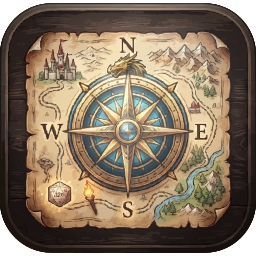

# RPG Mapping

Generador y visor de mapas para rol de mesa: mundos, regiones, aldeas, edificios, estancias y mazmorras, reproducibles por semilla. Vistas 2D cenital, 3D cenital y primera persona. Compatible con D&D 5e (SRD 5.2) y Pathfinder 2e (ORC). Sistema métrico e imperial. Partida compartida: el DM aloja y los jugadores se unen desde el navegador.

- Especificaciones: [`PROYECTO.md`](PROYECTO.md)
- Guía de trabajo: [`CLAUDE.md`](CLAUDE.md)
- Estado actual: [`SESSION_HANDOFF.md`](SESSION_HANDOFF.md)

Licencia del código: GPL-3.0-or-later (ver `LICENSE`). El contenido de reglas (`project/data/systems/` y `project/data/packs/`) **no** está bajo GPL, sino bajo su propia licencia: ver [`NOTICE.md`](NOTICE.md).

RPG Mapping no está afiliado ni respaldado por Wizards of the Coast ni por Paizo Inc. Dungeons & Dragons es marca de Wizards of the Coast LLC; Pathfinder es marca de Paizo Inc.
